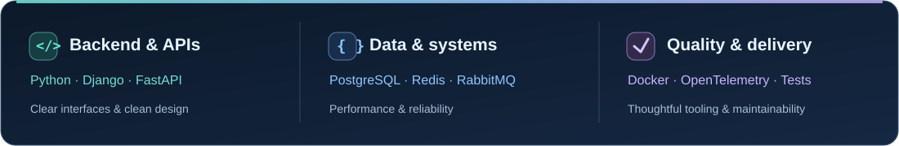

<!-- Minimal developer profile. Animated SVGs use no third-party scripts. -->

  

  &nbsp;
  

  

### Hi, I'm Erfan 👋

I'm a **Senior Software Engineer** who enjoys creating **reliable, maintainable software**. I focus on **backend engineering, API design, system architecture, performance, and automation** — and I like working across the stack when a good idea calls for it.

### What I enjoy building

  

I care about **clear interfaces**, **thoughtful architecture**, **fast and secure applications**, and **making systems easier to maintain**.

### My toolbox 🧰

**Backend & APIs**

  
  
  
  
  

**Data & infrastructure**

  
  
  
  
  

**Frontend & testing**

  
  
  

### A tiny coding break 🎮

  

A small browser game built with HTML, CSS animations &amp; JavaScript.

<strong>Build simply. Think deeply. Keep learning.</strong>

