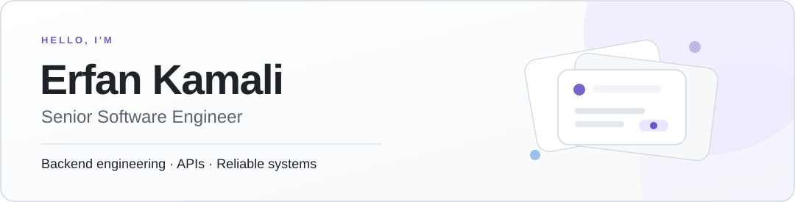
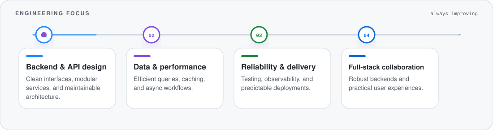
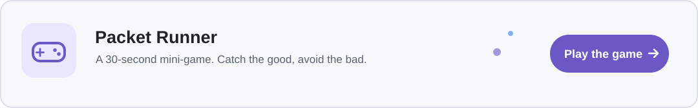

<!-- GitHub-native, light/dark responsive. No custom CSS is required. -->

  <picture>
    <source media="(max-width: 600px) and (prefers-color-scheme: dark)" srcset="./assets/hero-dark-mobile.svg">
    <source media="(max-width: 600px) and (prefers-color-scheme: light)" srcset="./assets/hero-light-mobile.svg">
    <source media="(prefers-color-scheme: dark)" srcset="./assets/hero-dark.svg">
    <source media="(prefers-color-scheme: light)" srcset="./assets/hero-light.svg">
    
  </picture>

  <a href="https://www.linkedin.com/in/erfankamali/">LinkedIn</a>
  &nbsp;·&nbsp;
  <a href="mailto:kamali77.erfan@gmail.com">Email me</a>
  &nbsp;·&nbsp;
  <a href="https://github.com/3rfun77">GitHub</a>

### A little about me

I'm a **Senior Software Engineer** who enjoys building **well-designed APIs, dependable services, and thoughtful software**. I care about clarity, performance, and making systems easier to maintain.

### Engineering focus

<picture>
  <source media="(max-width: 600px) and (prefers-color-scheme: dark)" srcset="./assets/focus-dark-mobile.svg">
  <source media="(max-width: 600px) and (prefers-color-scheme: light)" srcset="./assets/focus-light-mobile.svg">
  <source media="(prefers-color-scheme: dark)" srcset="./assets/focus-dark.svg">
  <source media="(prefers-color-scheme: light)" srcset="./assets/focus-light.svg">
  
</picture>

### Core stack

**Languages & Backend**  
<kbd>Python</kbd> <kbd>TypeScript</kbd> <kbd>Django</kbd> <kbd>FastAPI</kbd>

**Data & Messaging**  
<kbd>PostgreSQL</kbd> <kbd>Redis</kbd> <kbd>RabbitMQ</kbd> <kbd>Celery</kbd>

**Tools & Observability**  
<kbd>Docker</kbd> <kbd>OpenTelemetry</kbd> <kbd>Pytest</kbd>

**Frontend**  
<kbd>React</kbd>

### A little break 🎮

<a href="https://3rfun77.github.io/3rfun77/game/">
  <picture>
    <source media="(max-width: 600px) and (prefers-color-scheme: dark)" srcset="./assets/game-dark-mobile.svg">
    <source media="(max-width: 600px) and (prefers-color-scheme: light)" srcset="./assets/game-light-mobile.svg">
    <source media="(prefers-color-scheme: dark)" srcset="./assets/game-dark.svg">
    <source media="(prefers-color-scheme: light)" srcset="./assets/game-light.svg">
    
  </picture>
</a>

Built with HTML, CSS and JavaScript · <a href="https://3rfun77.github.io/3rfun77/game/">Open the game</a>

