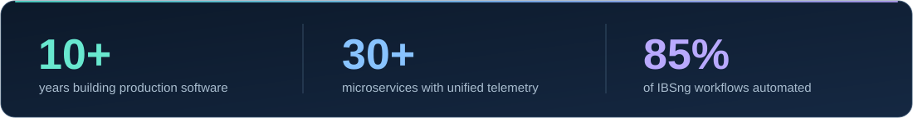
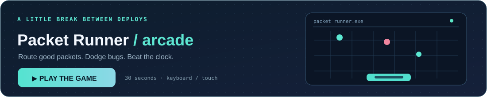

<!-- Erfan Kamali / GitHub profile. SVG motion is self-contained; no scripts run in this README. -->

  

  &nbsp;
  &nbsp;
  

  

### A little about me

I'm **Erfan**, a software engineer with **10+ years** of experience designing and operating backend systems. I work across **Python, Django, FastAPI, distributed services, and observability**—and I enjoy taking products from idea to production.

  

### Selected work

- **🔎 Observability at scale** — Built a custom **OpenTelemetry** toolkit adopted across **30+ microservices**, with tracing, logging, and instrumentation.
- **⚡ Automation that matters** — Architected a **Django + Celery + Redis** workflow engine automating **85% of IBSng operations** and reducing manual work by **70%**.
- **🐾 [Petmaan](https://petmaan.com)** — Founded and built a pet-care and veterinary management product with **Django REST, React, TypeScript, and PostgreSQL**.

### Toolbox

  
  
  
  
  
  
  
  
  
  

### A tiny interactive easter egg 🎮

  

30 seconds of packet routing, built with HTML, CSS animations &amp; JavaScript.

<strong>Build thoughtfully. Ship confidently. Observe everything.</strong>

